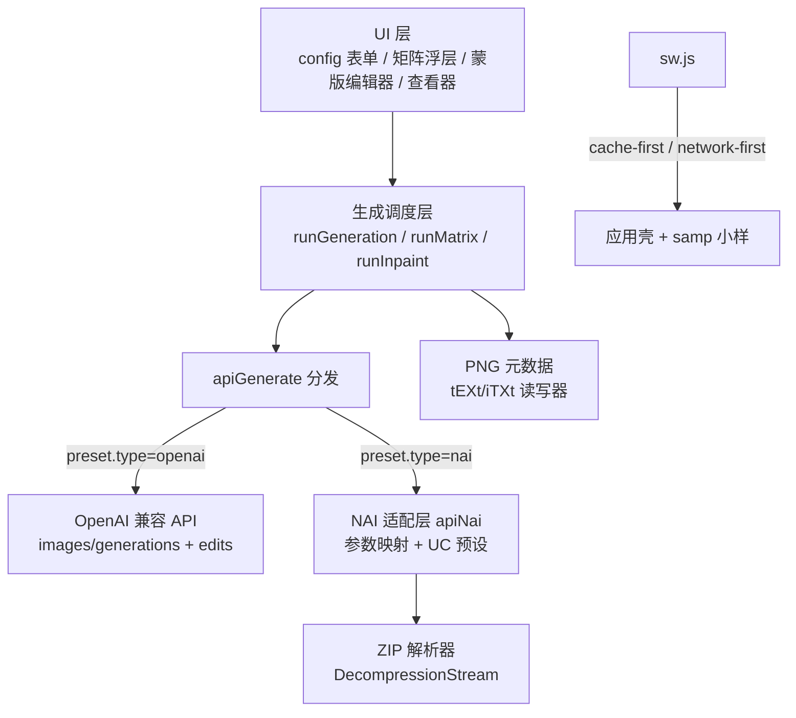

# NAI 直连与生图管线增强

Feature Name: nai-pipeline-upgrade
Updated: 2026-10-31

## Description

在保持单文件架构（`xiaoyi-paint.html`）与用户自带 Key 约定的前提下：
1. 新增 NovelAI 原生 API 提供方（持久 Token 鉴权），覆盖 txt2img / img2img / infill / vibe transfer；
2. 同 seed 画师串变体矩阵（2~4 格并排对比）；
3. 蒙版局部重绘（NAI infill + OpenAI edits 双通道）；
4. Service Worker 离线缓存与 PWA 安装；
5. PNG 元数据写入/读取（A1111 `parameters` + NAI `Comment` 双格式，往返一致）。

## Architecture



- `apiGenerate(p, opts)` 入口保持不变，内部按 `p.type` 分发，所有既有调用点（批量出样、画风实验、测试）自动获得 NAI 支持。
- NAI 响应为 ZIP（内含 PNG），由浏览器端 `DecompressionStream('deflate-raw')` 解压，零外部依赖。
- 参考图在 NAI 通道映射为 Vibe Transfer（`reference_image_multiple`），画风参考图体系直接复用。

## Components and Interfaces

### 1. 字节工具（新增，纯函数）

- `unzipFirstPng(bytes) -> Promise<Uint8Array>`：解析 EOCD → 中央目录 → 首个 .png 成员，method 0 直取 / method 8 走 `DecompressionStream`。
- `pngChunks(bytes) -> [{type,data}]` / `pngBuild(chunks) -> Uint8Array`：PNG chunk 级读写，重算 CRC。
- `pngWriteTexts(bytes, map) -> Uint8Array`：在 IHDR 后插入 tEXt（ASCII）与 iTXt（UTF-8，含中文用）。
- `pngReadTexts(bytes) -> {k:v}`：提取全部 tEXt/iTXt。
- `b64FromBytes / bytesFromDataUrl`：base64 转换。

### 2. NAI 适配层

常量：`NAI_MODELS`（8 个模型 + 默认尺寸 + 能力标注）、`NAI_SAMPLERS`（5 种）、`NAI_UC`（v3/v4/v4.5 官方 UC 预设串，按 heavy/light/human/none 分档）。

`naiParams(p, opts) -> 请求体`：
- 通用映射：size→width/height、steps（空=28）、negative_prompt（UC 预设串 + 用户负面词）、seed（空=随机）、sampler、`params_version:3`、`n_samples:1`、`cfg_rescale`、`noise_schedule:'karras'`、`qualityToggle`、`skip_cfg_above_sigma`（Variety+）。
- v4 系附加 `v4_prompt` / `v4_negative_prompt` 结构（`use_coords:false`、`use_order:true`，空 char_captions）。
- img2img：`action:'img2img'` + `image`（裸 base64）+ `strength`/`noise`。
- infill：`action:'infill'` + `image` + `mask`（白=重绘区）+ `add_original_image:true`。
- vibe：`reference_image_multiple` / `reference_information_extracted_multiple` / `reference_strength_multiple`（≤4 张，默认 0.7 / 0.6）。

`apiNai(p, opts)`：POST `https://image.novelai.net/ai/generate-image`，401/402 映射为中文错误提示，响应 ZIP → PNG → dataURL。
`naiSub(p)`：GET `api.novelai.net/user/subscription`，返回 {opus, active}。

### 3. 配置表单（`view-config`）

- 新增提供方二选一 segmented（OpenAI 兼容 / NovelAI），存入 `preset.type`（缺省 'openai'，兼容旧数据）。
- NAI 模式：隐藏 baseUrl（固定端点），`fKey` 存 Token（`pst-…`），「获取模型」按钮改为打开内置 NAI 模型清单 sheet。
- NAI 参数区（sampler / CFG scale / steps / UC 预设 / CFG rescale / Variety+ / 画质标签），存入 `preset.nai`。
- `btnTest`：NAI 预设改为验证 Token + 订阅档位（Opus 免费额度提示），零成本。

### 4. 同 seed 变体矩阵

- 新增浮层 `#mtxOv`：seed 展示与「换一个」、4 行画师串槽位（前 2 必填，后 2 可选）、每行「选」按钮打开串选择 sheet（内置 combos + myCombos + 词库 artist 词条）。
- `openMatrix(m)`：从消息快照取 `snap.en||prompt`、`snap.seed`（无则现场生成并锁定）、size/steps/sampler/neg。
- `runMatrix()`：`Promise.allSettled` 并发出图，网格 2×2 渲染，失败格显示原因 + 单格重试。
- 单格操作：查看大图 / 画师串存入词库 / 以此串回聊天继续 / 全部入库（推送为普通图片消息，自动进画廊）。

### 5. 局部重绘蒙版编辑器

- 新增浮层 `#inpOv`：图片底图 + 蒙版 canvas 叠加（红色 45% 高亮），工具栏：画笔/橡皮、粗细滑杆、撤销（笔画栈重绘）、清空、重绘强度滑杆（仅 NAI 生效）、修改说明输入（可选，追加进提示词）。
- 入口：查看器新增「局部重绘」按钮、聊天图片操作行、画廊长按 sheet。
- `runInpaint()`：蒙版按自然分辨率导出两张 —— NAI 用黑白 PNG（白=重绘），OpenAI 用透明 PNG（透明=可编辑区域）；NAI 通道自动切换到对应 inpainting 模型（映射表 + 确认提示）。
- 结果以普通图片消息入库（自动进画廊），记录关联原提示词。

### 6. PNG 元数据

- 写入时机：`runGeneration` 拿到图片后逐张嵌入（仅 PNG dataURL；JPEG 跳过），再入消息流。
- 键集：`Software`（Xiaoyi Paint）、`Source`（模型名）、`Description`（正向提示词）、`Comment`（JSON：prompt/en/steps/width/height/scale/seed/sampler/neg/provider/ucPreset）、`parameters`（A1111 文本格式，中文用 UTF-8 直写，与 A1111 生态一致）。
- 读取入口：查看器「图片信息 · 还原参数」按钮 + 画廊长按 sheet 同名项。
- 还原：解析 Comment（兼容 NAI 官网出图），将提示词回填输入框、负面词/seed/尺寸/采样器/steps 回填配置，并 toast 确认。

### 7. Service Worker（新文件 `sw.js`）

- 预缓存：`./`、`index.html`、`xiaoyi-paint.html`、`manifest.webmanifest`、图标。
- 策略：HTML 文档 network-first 回退缓存；同源静态资源（图标、`samp/`）cache-first + 运行时回填；跨域 API 请求直通网络，离线由业务层报错。
- 注册：`xiaoyi-paint.html` 初始化时（`file://` 协议跳过）；`controllerchange` 触发一次性「新版本已就绪」toast。

## Data Models

```js
preset = {
  id, name,
  type: 'openai' | 'nai',        // 旧数据缺省 'openai'
  baseUrl, key, model, chatModel, ocModel, models,
  nai: { sampler:'k_euler', scale:6, steps:28, ucPreset:'heavy',
         rescale:0, variety:false, quality:true }
}
MTX = { seed, base, size, steps, sampler, neg, jobs:[{str,img,err}] }
INP = { src, prompt, strokes:[{mode,size,pts[]}], strength, note }
```

PNG `Comment` JSON 为元数据契约，键名固定，向后兼容（读取时对缺失键容错）。

## Correctness Properties

- PNG 写入后仍是合法 PNG（IHDR 长度、CRC32 全部重算），任何标准解码器可打开。
- 元数据往返一致：本工具出图 → 读回 → prompt/neg/seed/size/steps/sampler 全等（R7.6）。
- ZIP 解析对 NAI 真实响应（deflate 存储 + 中央目录）成立；响应直接是 PNG 时直通。
- 矩阵内全部请求共享同一 seed 与通用参数，仅 prompt 不同（R3.5）。
- 蒙版导出尺寸与原图自然分辨率一致（NAI 校验 mask 尺寸）。
- 旧预设（无 type 字段）行为与升级前完全一致。

## Error Handling

| 场景 | 处理 |
|------|------|
| NAI 401 | 「Token 无效或已过期，去 NAI 网站重新生成」 |
| NAI 402 | 「Anlas 不足或参数超出订阅额度（Opus 免费额度：≤1024×1024 且 ≤28 步）」 |
| ZIP/PNG 解析失败 | 降级为原始响应尝试直读图片，仍失败则报错原文 |
| DecompressionStream 不可用（旧浏览器） | 提示浏览器过旧，建议 Chrome/Edge 103+ |
| 空蒙版提交 | 阻止并提示先涂抹 |
| SW 注册失败（file:// / 不支持） | 静默跳过，功能不受影响 |
| 元数据读取失败 | 「该图未包含生成信息」 |

## Test Strategy

- 字节工具单测式验证：浏览器控制台用内置样例 PNG 走 write→read round-trip；ZIP 用 NAI 真实响应（Token 配好后实测）。
- NAI 通道：配置页「测试」验证订阅；出一张 512×512 验证端到端；重绘验证 mask 尺寸校验通过。
- 矩阵：2 格 / 4 格 / 含失败格重试三条路径。
- SW：Lighthouse/DevTools Application 面板确认预缓存清单与离线加载。
- 回归：OpenAI 通道全流程（聊天生成、批量出样、画风实验）不回归。

## References

[^1]: (GitHub) - [Aedial/novelai-api · ImagePreset.py](https://github.com/Aedial/novelai-api/blob/main/novelai_api/ImagePreset.py) — NAI 模型清单、采样器、UC 预设串、v4_prompt/characterPrompts 结构
[^2]: (GitHub) - [NovelAI/novelai-image-metadata](https://github.com/NovelAI/novelai-image-metadata) — NAI PNG 元数据格式（tEXt + stealth alpha）
[^3]: (Filename#L1085) - xiaoyi-paint.html `apiGenerate` 现有实现
[^4]: (Filename#L4089) - xiaoyi-paint.html `runGeneration` 主流程
[^5]: (Filename#L4453) - xiaoyi-paint.html 配置表单 `fillForm`/`collectForm`
